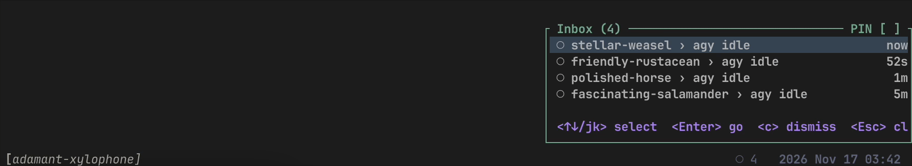

# zjstatus-inbox

A lightweight Zellij `0.46+` plugin that does two things:
1. **Pipes cross-session attention & reported-idle counts into [`zjstatus`](https://github.com/dj95/zjstatus)** (`{pipe_inbox}`), ignoring silent shell panes that have never emitted a status signal.
2. **Provides a subtle, dynamically-sized pop-over** (anchored flush above your bottom `zjstatus` bar) to view and jump directly to any tracked session/pane.

## Motivation

Zellij's built-in session manager is great for full session administration, but checking on background coding agents, long builds, or waiting prompts shouldn't require opening a full-screen modal. `zjstatus-inbox` gives you:
- **An at-a-glance status bar overview** in `zjstatus` that stays completely hidden when nothing has signaled.
- **A minimal, low-overhead pop-over** anchored in the corner so you can scan active/idle panes and jump straight to the right session, tab, and pane without losing context.

## How It Tracks State

`zjstatus-inbox` relies directly on Zellij `0.46+`'s native global attention tracking (see the [Zellij documentation](https://zellij.dev/documentation/)) rather than re-parsing terminal output itself. Silent shells that have never emitted a signal are ignored; panes that have reported status and later clear remain listed as `Idlle` until closed or dismissed.

---

## Quick Start

### 1. Plugin & Keybinding (`~/.config/zellij/config.kdl`)

Load `zjstatus-inbox` directly from the [latest GitHub release](https://github.com/seth-epps/zjstatus-inbox/releases/latest) at startup and bind a key (e.g., `Alt i`) to toggle the pop-over:

```kdl
load_plugins {
    "https://github.com/seth-epps/zjstatus-inbox/releases/<release>/download/zjstatus-inbox.wasm"
}

keybinds {
    shared_except "locked" {
        bind "Ctrl i" {
            MessagePlugin "https://github.com/seth-epps/zjstatus-inbox/releases/<release>/download/zjstatus-inbox.wasm" {
                name "toggle"
            }
        }
    }
}
```

> Or download `zjstatus-inbox.wasm` from [Releases](https://github.com/seth-epps/zjstatus-inbox/releases/latest) to `~/.config/zellij/plugins/zjstatus-inbox.wasm` and use `"file:~/.config/zellij/plugins/zjstatus-inbox.wasm"`.

### 2. `zjstatus` Layout (`~/.config/zellij/layouts/default.kdl`)

Add `{pipe_inbox}` to your `zjstatus` format string and configure its pipe options:

```kdl
layout {
    default_tab_template {
        children
        pane size=1 borderless=true {
            plugin location="file:~/.config/zellij/plugins/zjstatus.wasm" {
                format_left   "#[bold]{mode} [#[italic]{session}]"
                format_center "{tabs}"
                format_right  "{pipe_inbox} {datetime}"

                // Pass through the formatted counts and render #[fg=...,bold] tags dynamically
                pipe_inbox_format     "{output}"
                pipe_inbox_rendermode "dynamic"
            }
        }
    }
}
```

See [`examples/zjstatus-basic.png`](./examples/zjstatus-basic.png).

---

## Configuration Options

All options are optional and can be placed inside the `zjstatus-inbox` block in `plugins { ... }` in `~/.config/zellij/config.kdl`:

```kdl
plugins {
    zjstatus-inbox location="https://github.com/seth-epps/zjstatus-inbox/releases/latest/download/zjstatus-inbox.wasm" {
        // Floating pane border title (supports: {total}, {active}, {needs_you}, {failed}, {done}, {working}, {idle}, {summary}, {session})
        title           "Inbox ({total})"

        // Status bar formatting
        pipe_name       "pipe_inbox"
        count_format    "{icon}{count}"
        count_separator "  "
        bar_prefix      " "
        bar_suffix      " "
        show_zero       "false"

        // Icons & colors
        icon_needs_you  "● "
        icon_failed     "✗ "
        icon_done       "✓ "
        icon_working    "◐ "
        icon_idle       "○ "
        color_needs_you "#fab387"
        color_failed    "#f38ba8"
        color_done      "#a6e3a1"
        color_working   "#f9e2af"
        color_idle      "#6c7086"

        // Initial pop-over placement & responsive fallback thresholds
        anchor                "bottom-right"
        bottom_bar_rows       "1"
        popover_width         "52"
        popover_min_height    "5"
        popover_max_height    "16"
        fullscreen_below_cols "64"
        fullscreen_below_rows "12"
    }
}
```

## Build from Source

```sh
cargo build --release
cp target/wasm32-wasip1/release/zjstatus-inbox.wasm ~/.config/zellij/plugins/zjstatus-inbox.wasm
```
